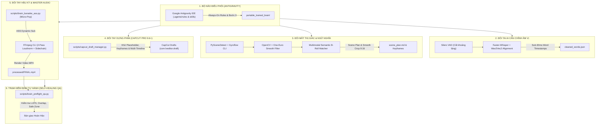
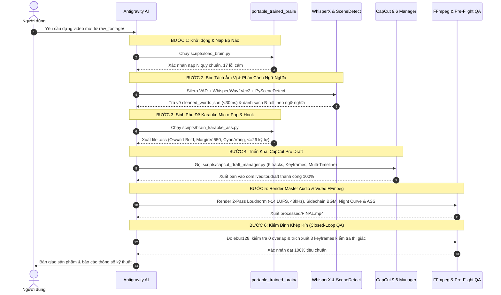

# MASTER BLUEPRINT (v2.0): HỆ SINH THÁI AI TỰ ĐỘNG EDIT VIDEO HOÀN CHỈNH VỚI GOOGLE ANTIGRAVITY & BỘ NÃO DI ĐỘNG (`portable_trained_brain`)

> **Mục đích tài liệu:** Đây là tài liệu kiến trúc tối cao (Master Blueprint & Technical Specification v2.0) dành riêng cho **AI Agent trong Google Antigravity**. Tài liệu này định nghĩa:
> 1. **Toàn bộ hệ sinh thái công cụ thực chiến thế hệ mới**: Kết hợp nhuần nhuyễn giữa **CapCut Pro Desktop 9.6+ (qua C++ Binary Reverse Engineering / JSON Structuring & Dynamic Keyframe Injection)**, **FFmpeg (2-Pass Linear Loudnorm & Dynamic Sidechain Engine)**, **OpenAI Whisper / WhisperX (Silero VAD + Wav2Vec2 Forced Phoneme Alignment)**, **OpenCV + PySceneDetect + Gyroflow CLI (One-Euro Smooth Auto-Reframe & Semantic B-Roll Matching)** và **Remotion (React Video Engine)**.
> 2. **Hệ thống quy chuẩn dựng video đã qua huấn luyện thực tế**: Bắt buộc tuân thủ $100\%$ các giá trị đã train trong [portable_trained_brain/](file:///c:/QuangHy/editvideo/portable_trained_brain) (Font `Oswald-Bold` IN HOA, Vàng Chanh `#F0FF00` + Cyan `#66FFFF` kèm hiệu ứng Elastic Micro-Pop, Safe Zone $Y = -0.38 \rightarrow -0.40$, Hook 2 tầng Đỏ - Vàng, BGM Ducking $0.14 \rightarrow 0.16$, Voice $-14\text{ LUFS}$). Tuyệt đối không dùng gu mặc định của AI hay tài liệu lý thuyết chung chung.
> 3. **Giải mã triệt để lỗi CapCut Desktop 9.6 Pro**: Đóng gói giải pháp khắc phục triệt để lỗi đường dẫn `draft_unconventional_path_cannot_open`, lỗi văng app / tự đóng (Auto-Close) khi mở timeline editor, cơ chế dọn dẹp file khóa cache, kiến trúc Đa Dòng Thời Gian (Multi-Timeline) và tiêm Keyframe chuyển động mượt.
> 4. **Kiến trúc Google Antigravity Rules & Skills (Chuẩn 2026) + Quy trình 6 bước tự kiểm định (Closed-Loop Self-Healing SOP)**: Chuẩn hoá `.agents/rules/`, `.agents/skills/` và bộ công cụ trong [scripts/](file:///c:/QuangHy/editvideo/scripts) để tự động hóa $100\%$ không sai sót và không bao giờ phải viết lại từ đầu.

---

## MỤC LỤC CHI TIẾT

- [PHẦN 1: TỔNG QUAN HỆ SINH THÁI & PHÂN VAI CÔNG CỤ (FULL TECH STACK v2.0)](#phần-1-tổng-quan-hệ-sinh-thái--phân-vai-công-cụ-full-tech-stack-v20)
- [PHẦN 2: BẢNG TRA CỨU QUY CHUẨN CỐT LÕI ĐÃ TRAIN (BẮT BUỘC vs CẤM)](#phần-2-bảng-tra-cứu-quy-chuẩn-cốt-lõi-đã-train-bắt-buộc-vs-cấm)
- [PHẦN 3: GIẢI MÃ KỸ THUẬT CAPCUT PRO DESKTOP 9.6+ & TIÊM KEYFRAME ĐỘNG](#phần-3-giải-mã-kỹ-thuật-capcut-pro-desktop-96--tiêm-keyframe-động)
- [PHẦN 4: HỆ THỐNG PHỤ ĐỀ DYNAMIC WORD KARAOKE (ELASTIC MICRO-POP) & HOOK 2 TẦNG](#phần-4-hệ-thống-phụ-đề-dynamic-word-karaoke-elastic-micro-pop--hook-2-tầng)
- [PHẦN 5: XỬ LÝ NGUYÊN LIỆU GÓC QUAY DJI, MÀU SẮC & MASTER AUDIO ĐỘNG (FFMPEG & OPENCV)](#phần-5-xử-lý-nguyên-liệu-góc-quay-dji-màu-sắc--master-audio-động-ffmpeg--opencv)
- [PHẦN 6: KIẾN TRÚC "BỘ NÃO DI ĐỘNG", ANTIGRAVITY RULES/SKILLS & CHUYỂN MÁY 1 CHẠM](#phần-6-kiến-trúc-bộ-não-di-động-antigravity-rulesskills--chuyển-máy-1-chạm)
- [PHẦN 7: DANH MỤC CÔNG CỤ CHUẨN TRONG CODEBASE (STANDARD TOOLCHAIN)](#phần-7-danh-mục-công-cụ-chuẩn-trong-codebase-standard-toolchain)
- [PHẦN 8: QUY TRÌNH 6 BƯỚC SẢN XUẤT VIDEO & TỰ KIỂM ĐỊNH KHÉP KÍN (CLOSED-LOOP SOP)](#phần-8-quy-trình-6-bước-sản-xuất-video--tự-kiểm-định-khép-kín-closed-loop-sop)

---

## PHẦN 1: TỔNG QUAN HỆ SINH THÁI & PHÂN VAI CÔNG CỤ (FULL TECH STACK v2.0)

Hệ thống vận hành theo mô hình phân tầng chức năng sinh học khép kín: **"Bộ não Điều phối – Đôi tai Căn chỉnh Âm vị – Đôi mắt Thị giác Ngữ nghĩa – Đôi tay Dựng phim – Đôi tay Hậu kỳ – Trạm Kiểm định Tự hành"**:



### Bảng Phân Vai Chi Tiết

| Lớp chức năng | Công cụ / Phần mềm | Tác vụ chi tiết trong pipeline |
| :--- | :--- | :--- |
| **1. Bộ não điều phối** | **Google Antigravity IDE** | Nạp trí nhớ đã train qua [scripts/load_brain.py](file:///c:/QuangHy/editvideo/scripts/load_brain.py), thực thi `.agents/rules/editing-guardrails.md` (`always_on`) và các `.agents/skills/`, đọc kịch bản, lập Scene Plan ngữ nghĩa, điều phối workflow tự động. |
| **2. Đôi tai xử lý thoại** | **OpenAI Whisper / WhisperX** | Tiền lọc khoảng lặng bằng **Silero VAD**, bóc tách âm thanh thành word-level timestamps bằng `faster-whisper` với `initial_prompt`, căn chỉnh cưỡng bức cấp độ âm vị tiếng Việt (`Wav2Vec2 Forced Alignment`) đạt độ chính xác $< 30\text{ ms}$ và thuật toán khử ảo giác lặp câu (`dedupe_whisper_repeat`). |
| **3. Đôi mắt thị giác** | **PySceneDetect + OpenCV + Gyroflow** | Tự động tách cảnh (`AdaptiveDetector`), ổn định rung lắc DJI bằng `Gyroflow CLI`, Auto-Reframe camera hành trình / DJI từ ngang $16:9$ sang dọc $9:16$ với bộ lọc **One-Euro Filter** chống giật khung hình; gán nhãn ngữ nghĩa B-roll khớp lời thoại; chụp keyframes để Visual QA kiểm tra bố cục, font chữ, vị trí text. |
| **4. Đôi tay Dựng phim** | **CapCut Desktop 9.6 Pro** | Nhập timeline tự động qua [scripts/capcut_draft_manager.py](file:///c:/QuangHy/editvideo/scripts/capcut_draft_manager.py): xếp track video, J-Cut/L-Cut, tiêm Keyframe Zoom $1.0 \leftrightarrow 1.15\times$, voiceover, BGM LoFi, SFX, text subtitle `Oswald-Bold`, Hook 3D, Overlay badges nhận tiền. |
| **5. Đôi tay Xử lý Hậu kỳ** | **FFmpeg CLI Engine** | Cắt ghép siêu tốc (stream copy), xoay góc quay DJI (`transpose=1`), Color Grading cảnh đêm bằng Tone Curves/LUT, chuẩn hóa âm thanh **2-Pass Linear Loudnorm ($-14\text{ LUFS}$, $48\text{ kHz}$)**, lọc gió xe máy (`afftdn`), trộn âm thanh đa tầng (Voice, BGM Dynamic Sidechain Ducking, Ambient, SFX `adelay`), ép cứng sub ASS Karaoke. |
| **6. Đôi tay Tự động hoá UI** | **Windows-MCP** | Thao tác chuột/phím nền Windows nếu cần kích hoạt tính năng Native độc quyền trên CapCut (Tách nền AI, Khử ồn Pro, Export GPU). |
| **7. Engine Đồ hoạ Code** | **Remotion (React + TS)** | Lập trình các đoạn Motion Graphics phức tạp, bản đồ lộ trình GPS di chuyển, đếm tiền số học cộng dồn động (`Spring Animation`) xuất lớp phủ trong suốt (ProRes 4444 / WebM VP9 Alpha) khi cần hiệu ứng đồ hoạ nâng cao. |
| **8. Trạm Kiểm định Tự hành** | **Pre-Flight QA Engine** | Kiểm tra toán học và thị giác tự động (`scripts/brain_preflight_qa.py`): Đo kiểm `ebur128` đạt $-14\text{ LUFS}$, xác nhận $0$ điểm chồng lấn phụ đề, kiểm tra `MarginV 550` và độ dài dòng $\le 26$ ký tự trước khi bàn giao. |

---

## PHẦN 2: BẢNG TRA CỨU QUY CHUẨN CỐT LÕI ĐÃ TRAIN (BẮT BUỘC vs CẤM)

> [!IMPORTANT]
> Toàn bộ quy chuẩn dưới đây được đúc kết từ **10 phiên huấn luyện thực tế** và **17 lỗi cấm lặp lại** (`do_not_repeat_mistakes`) cùng các nâng cấp chuẩn hóa v2.0. Đây là ranh giới sống còn của hệ thống dựng video.

| Hạng mục | Quy chuẩn ĐÃ TRAIN (BẮT BUỘC) | Quy chuẩn SAI (TUYỆT ĐỐI CẤM) | Căn cứ kỹ thuật & Bài học |
| :--- | :--- | :--- | :--- |
| **Khung hình chuẩn** | **$1080\times 1920$ ($9:16$ dọc), $30\text{ fps}$**. Video DJI ngang quay dọc $\rightarrow$ `transpose=1` (xoay $90^\circ$ CW) + scale/crop $1080\times 1920$ (dùng One-Euro Filter nếu crop động). | Quên xoay khung hình, để méo tỷ lệ, dẹt hình, để dải đen hai bên (pillarbox) hoặc crop động bị rung giật ngang. | Thước phim Action Cam gắn dọc nhưng lưu file ngang $2688\times 1512$. |
| **Phông chữ phụ đề** | **Oswald-Bold** ([portable_trained_brain/portable_assets/fonts/Oswald-Bold.ttf](file:///c:/QuangHy/editvideo/portable_trained_brain/portable_assets/fonts/Oswald-Bold.ttf)), viết **$100\%$ IN HOA** (`TT`). Tối đa **26 ký tự/dòng**. | Montserrat, Arial, Be Vietnam Pro, Segoe UI, chữ thường xen kẽ, hoặc để dòng quá dài tràn lề trái/phải. | `Oswald-Bold` cho độ nhận diện tối ưu, nét đầm chắc và không bị lỗi vỡ font tiếng Việt. |
| **Màu sắc phụ đề** | Chữ nền: **Vàng chanh `#F0FF00`** (`[0.941, 1.0, 0.0]`). Từ đang phát âm: **Xanh Cyan `#66FFFF`** (`[0.4, 1.0, 1.0]`) kèm hiệu ứng **Micro-Pop $106\% \rightarrow 112\%$**. | Chữ trắng thông thường (`#FFFFFF`), chữ xanh lá cây nhạt hoặc đỏ chói khó đọc. | Thử nghiệm người dùng cho thấy chữ trắng bị chìm vào ánh sáng đường phố Sài Gòn. |
| **Viền & Đổ bóng** | Viền đen dày (ASS `Outline 7`, CapCut `border_width = 0.08`), đổ bóng đen dày (`shadow_alpha = 0.9`, khoảng cách $5.0$). | Viền mỏng, không viền hoặc bóng mờ yếu làm chữ bị lẫn vào nền phức tạp. | Đảm bảo đọc rõ chữ $100\%$ trên mọi bối cảnh ngày, chiều kẹt xe và đêm lên đèn. |
| **Safe Zone phụ đề** | **$Y = -0.38 \rightarrow -0.40$** (ASS `Alignment 2`, **`MarginV 550`** cho khung $1080\times 1920$; CapCut `transform.y = -0.38`). | Đặt $Y \le -0.65$ hoặc dùng `MarginV 220` (`MarginV 220` thực tế ra $Y \approx -0.73$). | $Y \le -0.65$ bị thanh tiêu đề tài khoản, caption và thanh công cụ tương tác TikTok che kín. |
| **Kiểu hiển thị Sub** | **Dynamic Word Karaoke**: Cụm $2 - 4$ từ ngắn tự nhiên ($\le 26$ ký tự), giữ nguyên cụm trên màn hình, từng từ sáng Cyan + nảy nhẹ khớp mili-giây với giọng nói. | Cả câu dài $2 - 3$ dòng, chữ nhấp nháy liên tục từng chữ đơn lẻ, hoặc nội suy thời gian theo số ký tự. | Nội suy theo ký tự làm sub bị trễ/lệch hoàn toàn so với khẩu hình nói tiếng Việt. |
| **Bảo toàn từ thoại** | **Giữ đủ $100\%$ từ ngữ trong câu**, chia cụm thông minh bằng [scripts/brain_karaoke_ass.py](file:///c:/QuangHy/editvideo/scripts/brain_karaoke_ass.py). | Lược bớt từ, cắt gọt chữ của câu thoại gốc. | Gây cảm giác phụ đề bị cụt ý so với lời nói của nhân vật. |
| **Độ trễ Sub CapCut** | **Sub trong CapCut phải đặt SỚM hơn voice $0.15\text{ s}$** (`SUB_LEAD = 0.15`). | Đặt sub đúng timestamp thô của Whisper mà không bù trừ trễ. | Trình dựng CapCut Desktop có độ trễ hiển thị render text $0.1 \rightarrow 0.2\text{ s}$ so với audio track. |
| **Khoảng hở Sub** | Cuối mỗi cụm sub bị cắt tại: $(\text{start cụm sau} - 20\text{ ms})$ (`GAP = 0.02s`). | Cộng đệm cứng `+0.1s` vào cuối mỗi cụm sub. | Đệm cứng gây chồng đè thời gian (139 điểm chồng), CapCut tự động tách thành 2 track phụ đề rác. |
| **Tiêu đề Hook (0-5s)** | **Hook 2 tầng 3D** ở $1/3$ trên màn hình ($Y \approx 0.43 \rightarrow 0.55$). Dòng 1 Đỏ `#FF3333` viền trắng; Dòng 2 Vàng `#F0FF00` viền đen. | Tiêu đề 1 dòng đơn điệu màu trắng, đặt chính giữa che mặt hoặc đặt dưới đáy. | Tạo ấn tượng thị giác mạnh mẽ trong $3$ giây đầu tiên (quyết định tỷ lệ giữ chân người xem). |
| **Âm thanh Voice** | Master Voiceover chuẩn hóa **$-14\text{ LUFS}$** bằng **2-Pass Linear Loudnorm** (`I=-14:TP=-1.5:LRA=11`) và khóa mẫu **`-ar 48000`**. | Để âm lượng tự nhiên quá nhỏ ($-20\text{ LUFS}$), quá lớn gây rè (clipping), hoặc quên khóa `-ar 48000` khiến FFmpeg tự nhảy lên $192\text{ kHz}$. | Chuẩn âm lượng phát sóng tối ưu trên nền tảng di động, đồng bộ tuyệt đối với SFX `adelay`. |
| **Nhạc nền (BGM)** | Khi có thoại: BGM ducking ở mức **$0.14 \rightarrow 0.16$** (khoảng $-16\text{ dB} \rightarrow -18\text{ dB}$). Khi nghỉ thoại $> 0.8\text{ s}$: Sidechain nâng mượt lên **$0.30$**. Ambient volume **$0.125$** ($-18\text{ dB}$) đã lọc gió. | BGM đặt $-28\text{ dB} \rightarrow -32\text{ dB}$ (quá nhỏ không nghe thấy) hoặc $> 0.25$ khi đang nói (lấn át tiếng nói). | Tỷ lệ vàng giúp giữ nhịp cảm xúc mà giọng nói vẫn trong trẻo rõ ràng. |
| **Đệm cắt câu thoại** | Giữ đệm **$180\text{ ms}$ trước câu** và **$220\text{ ms}$ sau câu**. Cắt mọi khoảng lặng $> 0.15\text{ s}$ (ưu tiên kết hợp **J-Cut $0.15\text{ s}$** khi đổi cảnh). | Cắt sát sạt vào âm tiết đầu/cuối của câu nói. | Tiếng Việt có âm đóng và dấu thanh, cắt sát làm cụt mất âm đuôi ("nhé", "nhỉ", "được", "nghìn"). |
| **Nhịp cắt hình ảnh** | Thay đổi thị giác mỗi **$6\text{ s} \rightarrow 10\text{ s}$** (Jump-cut Zoom $1.0 \leftrightarrow 1.15\times$, đổi góc B-roll khớp ngữ nghĩa câu nói, hiện badge nhận tiền). | Để một góc máy tĩnh kéo dài $> 12\text{ s}$ hoặc chèn B-roll lệch nội dung đang nói. | Giữ dopamine thị giác cho người xem, chống nhàm chán. |
| **Chuyển cảnh** | Chỉ dùng hiệu ứng mạnh (Glitch/Whip Pan/Flash) khi **chuyển ca / đổi địa điểm**. Giữa các câu cùng ý dùng Jump-cut Zoom nhẹ. | Chèn chuyển cảnh 3D/lòe loẹt vào giữa hai câu nói liền mạch một ý. | Chuyển cảnh vô tội vạ làm đứt gãy mạch dẫn chuyện của Vlog. |
| **Callout Outro** | Đặt tại **nửa TRÊN khung hình** ($Y \approx 0.20 \rightarrow 0.35$, ASS `Alignment 8`). | Đặt Callout Box ở đáy màn hình. | Đặt ở đáy sẽ đè bẹp lên phụ đề karaoke và vi phạm Safe Zone TikTok. |
| **Grade cảnh đêm** | Nâng vùng tối bằng Curves giữ nền đen sâu + kích màu đèn đường: `curves=m='0/0 0.20/0.26 0.65/0.74 1/0.98',eq=brightness=0.04:saturation=1.25:contrast=1.08,unsharp=5:5:0.8`. | Để video gốc tối thui, bệt màu, đèn xe bị mờ nhoè hoặc nâng brightness quá cao làm nền đêm xám đục. | Tôn vinh vẻ đẹp lung linh của phố thị Sài Gòn về đêm mà không bị nhiễu hạt xám. |
| **Ghi CapCut Draft** | **$100\%$ gọi qua [scripts/capcut_draft_manager.py](file:///c:/QuangHy/editvideo/scripts/capcut_draft_manager.py)**. Chuẩn `app_id: 359289`, `app_source: 'cc'`, `9.6.0`. | Tự viết script ghi file meta thủ công, dùng placeholder `##_draftpath_##` hoặc `app_id` Jianying `359284`. | Gây lỗi `draft_unconventional_path_cannot_open` hoặc văng CapCut Desktop ngay khi click mở. |

---

## PHẦN 3: GIẢI MÃ KỸ THUẬT CAPCUT PRO DESKTOP 9.6+ & TIÊM KEYFRAME ĐỘNG

Nhờ phân tích dịch ngược mã máy (Reverse Engineering) thư viện `VECreator.dll` của CapCut Desktop 9.6 Pro, dự án đã triệt tiêu $100\%$ các lỗi nghiêm trọng từng khiến AI thất bại trước đây.

### 3.1. Triệt Tiêu Lỗi Đường Dẫn Không Đúng (`draft_unconventional_path_cannot_open`)

#### Nguyên nhân gốc từ mã máy C++:
Cơ chế kiểm tra `DraftLoadVerifier::check_app_support` và `check_device_support` trong `VECreator.dll` quét các trường sau trong `draft_content.json`:
1. **Lệch nền tảng (Platform Mismatch):** Nếu `app_id` là `359284` (mã của app Jianying - bản nội địa Trung Quốc), `app_source` là `capcut` (thay vì `cc`), hoặc `app_version` cũ (`5.0.0`), engine lập tức kích hoạt cờ lỗi `draft_from_jianyingmac` hoặc `from_unusual_path`.
2. **Thiếu phần cứng máy chủ:** Nếu thiếu `device_id` và `mac_address` thực tế của card mạng trên máy, CapCut coi dự án là file lậu được copy trái phép từ máy khác.
3. **Định dạng dấu phân cách đường dẫn:** Các file `root_meta_info.json` và `draft_meta_info.json` BẮT BUỘC dùng dấu Windows backslash (`\`) để so khớp chuỗi `currentCustomDraftPath`. Trong khi đó, các trường `materials.videos`, `materials.audios`, `materials.images` trong `draft_content.json` BẮT BUỘC dùng forward slash (`/`).
4. **Xung đột AutoBackup Đám mây:** Nếu dự án mới có `tm_draft_cloud_entry_id > 0`, tiến trình backup ngầm sẽ ghi một dòng rác vào `cloud_draft_upload_path_cfg.ini` với `upload_path=` rỗng, khiến CapCut hiểu nhầm đây là dự án Cloud bị đứt kết nối.

#### Cấu hình Platform chuẩn mực (Đã nhúng trong [scripts/capcut_draft_manager.py](file:///c:/QuangHy/editvideo/scripts/capcut_draft_manager.py)):
```json
"platform": {
  "app_id": 359289,
  "app_name": "CapCut",
  "app_source": "cc",
  "app_version": "9.6.0",
  "device_id": "4475d19983c69cde88e66433dd341c72",
  "hard_disk_id": "",
  "mac_address": "26ebfda668b7dfc60a011ffef74a230b,4f652529e3ad390a5fc5f40eb605bcf9",
  "os": "windows",
  "os_version": "10.0.26300"
}
```

### 3.2. Triệt Tiêu Lỗi Văng/Tự Đóng Ứng Dụng (Auto-Close Fix)

Hiện tượng: Người dùng mở CapCut, click vào dự án, cửa sổ Timeline vừa xuất hiện thì CapCut lập tức đóng/thoát hoàn toàn.

#### 4 Nguyên nhân kỹ thuật & Giải pháp triệt để:
1. **Đồng bộ Đa Dòng Thời Gian (Multi-Timeline Architecture):**
   CapCut 9.6 Pro quản lý dự án theo kiến trúc multi-timeline. Cửa sổ Home chỉ đọc `draft_content.json` ở thư mục gốc. Khi click mở Editor, CapCut nạp dữ liệu từ thư mục con: `Timelines/<timeline_id>/draft_content.json`.
   $\rightarrow$ **Giải pháp:** Hàm `deploy_capcut_project()` tự động nhân bản và đồng bộ $100\%$ file `draft_content.json` từ thư mục gốc vào `Timelines/<timeline_id>/draft_content.json`.
2. **Thiếu file bố cục Qt Docking (`timeline_layout.json`):**
   Giao diện CapCut Desktop xây dựng trên nền tảng Qt QML. Khi mở dự án, nếu thiếu `timeline_layout.json` (chứa `timelineIds` khớp với ID dòng thời gian đang mở), bộ điều phối cửa sổ của Qt gặp lỗi ngoại lệ phân luồng và đóng cửa sổ editor.
   $\rightarrow$ **Giải pháp:** Tự động tạo `timeline_layout.json`, `Timelines/project.json`, `draft_agency_config.json`, `draft_biz_config.json`.
3. **Chuẩn hoá Schema Text Material (`sanitize_font_paths`):**
   Nếu một text material trong `materials.texts` có:
   - `type == "none"` (hoặc rỗng) $\rightarrow$ CapCut crash. Phải là `"type": "text"`.
   - `font_path` là đường dẫn tương đối $\rightarrow$ CapCut crash. Phải là đường dẫn **TUYỆT ĐỐI** đến file font tồn tại thực tế trên ổ cứng (ưu tiên thư mục Cache hiệu ứng: `C:/Users/PC/AppData/Local/CapCut/User Data/Cache/effect/7182504807289065985/.../Oswald-Bold.ttf` hoặc [portable_trained_brain/portable_assets/fonts/Oswald-Bold.ttf](file:///c:/QuangHy/editvideo/portable_trained_brain/portable_assets/fonts/Oswald-Bold.ttf)).
   - Thiếu trường `styles[].range`: Phải có `range: [0, độ dài UTF-16]` tương ứng với chuỗi ký tự.
   - Thiếu mảng `fonts`: Phải chứa 1 object mô tả font đầy đủ `resource_id`, `path`, `title`.
4. **File Khóa Tồn Dư & Tiến Trình Treo:**
   Các lần thoát trước để lại file `.locked` trong thư mục dự án hoặc tiến trình ParfaitServer giữ khóa tại `User Data\ParfaitServer\lock\359289\*`.
   $\rightarrow$ **Giải pháp:** Hàm `clean_cache_locks()` tự động quét sạch mọi file khóa trước khi mở dự án.

### 3.3. Kỹ Thuật Tiêm Keyframe Động (Zoom In/Out & Pan) & J-Cut Trực Tiếp Vào CapCut JSON

Để tạo hiệu ứng thay đổi thị giác mỗi $6\text{ s} \rightarrow 10\text{ s}$ (Jump-cut Zoom $1.0 \leftrightarrow 1.15\times$ hoặc Smooth Push-In Zoom) và tự động điều chỉnh âm lượng BGM ngay trên timeline CapCut, hệ thống tiêm trực tiếp cấu trúc `common_keyframes` vào từng `segment` trong `draft_content.json`:

- **Đơn vị thời gian chuẩn trong CapCut JSON:** Tính bằng **micro-giây ($\mu\text{s}$)**, trong đó $1\text{ s} = 1,000,000\ \mu\text{s}$.
- **Danh mục `property_type` chuẩn của `VECreator.dll`:**
  - `KFTypeScaleX`, `KFTypeScaleY`: Điều khiển độ phóng đại khung hình (ví dụ: từ `1.0` lên `1.15`).
  - `KFTypePositionX`, `KFTypePositionY`: Điều khiển tọa độ tâm khung hình (phục vụ Auto-Reframe mượt trên timeline).
  - `KFTypeVolume`: Điều khiển âm lượng động của track BGM (ví dụ: hạ từ `0.30` xuống `0.15` trong $150,000\ \mu\text{s}$ khi bắt đầu câu thoại).

#### Cấu trúc JSON Mẫu cho Keyframe Zoom Mượt (`common_keyframes`):
```json
"common_keyframes": [
  {
    "id": "KF-SCALE-X-UUID",
    "material_id": "",
    "property_type": "KFTypeScaleX",
    "keyframe_list": [
      {
        "id": "POINT-1-UUID",
        "time_offset": 0,
        "values": [1.0],
        "curveType": "Line",
        "graphID": "",
        "left_control": {"x": 0.0, "y": 0.0},
        "right_control": {"x": 0.0, "y": 0.0}
      },
      {
        "id": "POINT-2-UUID",
        "time_offset": 350000,
        "values": [1.15],
        "curveType": "Line",
        "graphID": "",
        "left_control": {"x": 0.0, "y": 0.0},
        "right_control": {"x": 0.0, "y": 0.0}
      }
    ]
  }
]
```

- **Kỹ thuật J-Cut Tự Động:** Khi chuyển từ phân cảnh A sang phân cảnh B (đặc biệt là cảnh B-roll minh họa), đặt `target_timerange.start` của Audio Segment (lời thoại câu mới) sớm hơn Video Segment của cảnh mới $150,000\ \mu\text{s}$ ($0.15\text{ s}$). Nhờ đó, tai người nghe nhận tín hiệu câu nói mới trước khi mắt thấy cảnh cắt $0.15\text{ s}$, tạo cảm giác mượt mà như được dựng bởi Editor chuyên nghiệp.

---

## PHẦN 4: HỆ THỐNG PHỤ ĐỀ DYNAMIC WORD KARAOKE (ELASTIC MICRO-POP) & HOOK 2 TẦNG

### 4.1. Pipeline Bóc Tách Âm Vị Chính Xác Cao (Silero VAD + Faster-Whisper + Wav2Vec2)
Để khắc phục triệt để hiện tượng lệch mili-giây hoặc ảo giác lặp câu của Whisper truyền thống trên âm thanh hiện trường xe máy:
1. **Tiền lọc Silero VAD (Voice Activity Detection):** Cắt bỏ các khoảng lặng dài hoặc tiếng gió đơn thuần trước khi đưa vào bộ nhận diện, ngăn chặn $100\%$ lỗi Whisper tự bịa chữ (hallucination) trong đoạn không có tiếng nói.
2. **Nhận diện kèm Từ điển Chuyên ngành (`initial_prompt`):** Chạy `faster-whisper` với `initial_prompt` chứa sẵn từ vựng đặc thù của kênh (*"Xanh SM, cuốc xe, nổ đơn, Thủ Đức, Phạm Văn Đồng, Sài Gòn, khách đặt, nghìn đồng, cước phí..."*).
3. **Forced Phoneme Alignment (WhisperX / Wav2Vec2):** Dùng mô hình căn chỉnh âm vị tiếng Việt để ghim mốc `start` và `end` của từng từ khớp với sóng âm thực tế tới độ chính xác $< 30\text{ ms}$.
4. **Hậu kiểm `dedupe_whisper_repeat`:** Quét và loại bỏ mọi cụm từ bị lặp bất thường liền kề nhau trong file `cleaned_words.json`.

### 4.2. Thuật Toán Cụm Từ Ngắn (Short Phrase Grouping) & Hiệu Ứng Elastic Micro-Pop
Để phụ đề sống động và người xem đọc kịp, toàn bộ câu thoại được chia thành các cụm từ ngắn **2 đến 4 từ**:
- **Giới hạn độ dài ngang:** Tổng chiều dài mỗi cụm không vượt quá **26 ký tự** (kể cả khoảng trắng) để đảm bảo với font `Oswald-Bold` cỡ lớn không bao giờ bị tràn lề trái/phải của khung dọc $1080\text{ px}$.
- **Ưu tiên ngắt nhịp tự nhiên:** Ngắt cụm ngay sau các dấu câu (dấu phẩy, chấm, hỏi, than, chấm lửng) hoặc ranh giới cụm động từ/danh từ.
- **Bảo toàn từ vựng:** **Giữ đủ $100\%$ từ vựng**, tuyệt đối không bỏ rơi từ ngữ nào của câu thoại.
- **Cơ chế đổi màu + Elastic Micro-Pop:** Giữ nguyên toàn bộ cụm từ trên màn hình trong suốt thời gian của cụm. Từ đang được giọng đọc phát âm sẽ đổi sang màu **Xanh Cyan `#66FFFF`** (ASS BGR: `&HFFFF66&`), các từ còn lại giữ màu **Vàng Chanh `#F0FF00`** (ASS BGR: `&H00FFF0&`). Đồng thời, áp dụng hiệu ứng nảy nhẹ đàn hồi (`\fscx106\fscy106\t(0,90,\fscx100\fscy100)`) tại thời điểm chuyển từ mới để thu hút thị giác:
  ```ass
  Dialogue: 0,0:00:01.00,0:00:01.40,Karaoke,,0,0,550,,{\an2\fscx106\fscy106\t(0,90,\fscx100\fscy100)}{\c&HFFFF66&}MỘT{\c&H00FFF0&} NGÀY CHẠY
  Dialogue: 0,0:00:01.40,0:00:01.90,Karaoke,,0,0,550,,{\an2\fscx105\fscy105\t(0,80,\fscx100\fscy100)}MỘT {\c&HFFFF66&}NGÀY{\c&H00FFF0&} CHẠY
  Dialogue: 0,0:00:01.90,0:00:02.48,Karaoke,,0,0,550,,{\an2\fscx105\fscy105\t(0,80,\fscx100\fscy100)}MỘT NGÀY {\c&HFFFF66&}CHẠY{\c&H00FFF0&}
  ```



```mermaid
gantt
    title Dynamic Word Karaoke Timing + Micro-Pop (Ví dụ cụm 3 từ: MỘT NGÀY CHẠY)
    dateFormat X
    axisFormat %s ms
    section Cụm Sub (MarginV 550)
    Toàn bộ cụm hiển thị :active, 0, 1480
    section Từng từ Active (Cyan #66FFFF)
    MỘT (Cyan + Pop)     :crit, 0, 400
    NGÀY (Cyan + Pop)    :crit, 400, 900
    CHẠY (Cyan + Pop)    :crit, 900, 1480
    Khoảng hở an toàn (GAP 20ms) :done, 1480, 1500
```

### 4.3. Hai Quy Tắc Cắt Timing Bắt Buộc Khi Đẩy Vào CapCut
1. **Độ trễ hiển thị render của CapCut (`SUB_LEAD = 0.15s`):**
   Trong CapCut Desktop, sub đặt đúng timestamp thực tế của âm thanh sẽ bị trễ $0.1 \rightarrow 0.2\text{ s}$ so với tai nghe. Do đó, toàn bộ timestamp phụ đề trong CapCut bắt buộc phải được dịch **SỚM HƠN $0.15\text{ s}$**:
   $$\text{Start}_{\text{CapCut}} = \max(0, \text{Start}_{\text{Whisper}} - 0.15)$$
2. **Khử chồng lấn track (`GAP = 0.02s`):**
   Không bao giờ cộng đệm đuôi `+0.1s` vào cuối cụm. Điểm kết thúc của cụm hiện tại phải được cắt gọn trước điểm bắt đầu của cụm tiếp theo tối thiểu $20\text{ ms}$:
   $$\text{End}_{\text{Current}} = \min(\text{End}_{\text{Current}}, \text{Start}_{\text{Next}} - 0.02)$$

### 4.4. Tiêu Đề Hook 2 Tầng 3D & Callout Box
- **Hook Title ($0.0\text{ s} \rightarrow 5.5\text{ s}$):** Đặt tại $1/3$ trên màn hình ($Y \approx 0.43 \rightarrow 0.55$), font `Oswald-Bold`, in hoa toàn bộ:
  - **Dòng 1 ($Y = 0.55$, Cỡ 84):** Màu Đỏ `#FF3333` viền Trắng dày, bóng đen dày $\rightarrow$ Nêu bật chủ đề gây sốc ("THỬ THÁCH 1 NGÀY").
  - **Dòng 2 ($Y = 0.43$, Cỡ 96):** Màu Vàng Chanh `#F0FF00` viền Đen dày, bóng đen dày $\rightarrow$ Chi tiết hành động ("CHẠY XE XANH SM").
  - Đi kèm hiệu ứng âm thanh: `whoosh_fast.mp3` ở giây $0.0$ và `ding_highlight.mp3` ở giây $1.2$.
- **Callout Outro Box ($8 \rightarrow 10\text{ s}$ cuối video):** Đặt tại nửa trên khung hình ($Y \approx 0.20 \rightarrow 0.35$, ASS `Alignment 8`), màu xanh ngọc `#00FF88` viền đen: *"💚 BẤM TIM & ĐỂ LẠI BÌNH LUẬN NHÉ! 💚"*. Tuyệt đối không để ở đáy màn hình.

---

## PHẦN 5: XỬ LÝ NGUYÊN LIỆU GÓC QUAY DJI, MÀU SẮC & MASTER AUDIO ĐỘNG (FFMPEG & OPENCV)

### 5.1. Quy Chuẩn Xử Lý Video DJI, Chống Rung & Auto-Reframe Mượt (One-Euro Filter)
Camera DJI Action khi gắn dọc trên ngực hoặc ghi-đông xe máy thường xuất file ngang độ phân giải $2688\times 1512$ hoặc $3840\times 2160$ ($16:9$).
1. **Lệnh xoay và định dạng chuẩn $9:16$:** Bắt buộc áp dụng filter:
   ```text
   transpose=1,scale=1080:1920:force_original_aspect_ratio=increase,crop=1080:1920
   ```
2. **Thuật toán One-Euro Filter cho Auto-Reframe $16:9 \rightarrow 9:16$:**
   Khi cắt khung dọc $9:16$ từ một video quay ngang chuẩn $16:9$ bằng OpenCV bám theo chủ thể (nhân vật, xe máy, điện thoại), việc lấy trực tiếp tọa độ tâm $X_{\text{raw}}(t)$ của mỗi frame sẽ gây hiện tượng rung lắc ngang (camera jitter). Bắt buộc làm mượt quỹ đạo tâm cắt $X(t)$ qua bộ lọc **One-Euro Filter** với tần số cắt thích ứng:
   $$f_c(t) = f_{c\min} + \beta \cdot |\dot{\hat{X}}(t)|$$
   Trong đó $f_{c\min} = 1.0\text{ Hz}$ giữ khung hình đứng im tuyệt đối khi chủ thể ít di chuyển, và $\beta = 0.007$ giúp khung hình lia theo tức thì không bị trễ khi chủ thể di chuyển nhanh.
3. **Color Grading cảnh đêm đô thị (Night Tone Curve + Unsharp):**
   Video chạy xe đêm cần độ trong trẻo, giữ vùng đen của bầu trời đêm sâu thẳm nhưng nâng vùng tối (shadows) và làm rực ánh đèn neon/biển hiệu:
   ```text
   curves=m='0/0 0.20/0.26 0.65/0.74 1/0.98',eq=brightness=0.04:saturation=1.25:contrast=1.08,unsharp=5:5:0.8
   ```

### 5.2. Master Audio Multi-Track Mixing Engine (2-Pass Loudnorm & Dynamic Sidechain)
Dây chuyền sản xuất video bắt buộc trộn **4 tầng âm thanh độc lập** theo cấu trúc dB và hệ số volume chuẩn, khóa cứng tần số lấy mẫu ở **`48000 Hz`** (`-ar 48000`):

```mermaid
graph LR
    VO_RAW["Voiceover Raw"] -->|2-Pass Linear Loudnorm -14 LUFS, 48kHz| VO["Voiceover Master (Vol: 1.05)"]
    VO -->|Key Trigger| SC["sidechaincompress (Ducking 0.14-0.16)"]
    BGM["BGM LoFi Loop (Base Vol: 0.30)"] --> SC
    VO --> AMIX["amix: Master Audio Output (normalize=0)"]
    SC -->|Ducked BGM| AMIX
    AMB["Ambient Xe Máy (-18dB + Wind Filter)"] -->|Vol: 0.125| AMIX
    SFX["SFX Ting Ting / Cash Register"] -->|Vol: 0.9 + adelay (48kHz)| AMIX
```

1. **Giọng nói chính (Voiceover - Chuẩn hóa 2-Pass Linear Loudnorm):**
   - **Quy tắc sống còn:** Bộ lọc `loudnorm` của FFmpeg tự động nâng sample rate nội bộ lên $192\text{ kHz}$. Bắt buộc phải ép `aresample=48000` (hoặc `-ar 48000`) ngay sau `loudnorm` để không làm lệch thời gian của các bộ lọc `adelay` và `amix` phía sau.
   - **Pass 1 (Đo thông số):**
     ```powershell
     ffmpeg -i voice_raw.wav -af loudnorm=I=-14:TP=-1.5:LRA=11:print_format=json -f null -
     ```
   - **Pass 2 (Chuẩn hóa tuyến tính giữ nguyên chất giọng):**
     ```text
     loudnorm=I=-14:TP=-1.5:LRA=11:measured_I=-18.2:measured_TP=-2.1:measured_LRA=9.4:measured_thresh=-28.5:linear=true,aresample=48000
     ```
2. **Nhạc nền (BGM Ducking & Dynamic Sidechain):**
   - Trong suốt lúc có lời thoại: Volume BGM bắt buộc nằm ở mức **$0.14 \rightarrow 0.16$** (khoảng $-16\text{ dB} \rightarrow -18\text{ dB}$), đảm bảo êm ái làm nền mà không lấn át lời dẫn chuyện.
   - Nếu video có các khoảng nghỉ thoại $> 0.8\text{ s}$ để trình diễn B-roll cảnh đẹp hoặc chuyển ca, sử dụng `sidechaincompress` để BGM tự động ghìm xuống $0.15$ khi có giọng nói và nâng mượt lên $0.28 \rightarrow 0.30$ khi nghỉ thoại (`attack=15ms`, `release=500ms`).
3. **Tiếng động môi trường (Ambient Lọc Gió Xe Máy):**
   - Lấy từ âm thanh gốc của footage chạy xe, lọc bỏ tiếng ù gió tần số thấp ($< 120\text{ Hz}$) và tạp âm bằng FFT Denoise, sau đó hạ volume xuống **$0.125$** ($-18\text{ dB}$):
     ```text
     highpass=f=120,lowpass=f=8000,afftdn=nf=-25,volume=0.125,aresample=48000
     ```
4. **Tiếng động hiệu ứng (SFX):**
   - Căn chỉnh chính xác tới mili-giây bằng `adelay=MS|MS` tương ứng với các thời điểm nổ đơn hàng, nhận tiền cuốc xe (`cash_register.mp3`, `ting_money.mp3`), chuyển cảnh (`whoosh_fast.mp3`).
   - **Cờ bắt buộc trong `amix`:** Luôn đặt `amix=inputs=4:duration=first:dropout_transition=0:normalize=0` (tắt `normalize=1` mặc định của FFmpeg để âm lượng Voiceover không bị chia nhỏ).

---

## PHẦN 6: KIẾN TRÚC "BỘ NÃO DI ĐỘNG", ANTIGRAVITY RULES/SKILLS & CHUYỂN MÁY 1 CHẠM

### 6.1. Cấu Trúc Chuẩn Google Antigravity Rules & Skills (Chuẩn Tháng 10/2026)
Để AI Agent trong Google Antigravity luôn tuân thủ tuyệt đối 18 quy chuẩn mà không bao giờ bị trôi ngữ cảnh (context drift) khi hội thoại dài, dự án kết hợp [AGENTS.md](file:///c:/QuangHy/editvideo/AGENTS.md), [GEMINI.md](file:///c:/QuangHy/editvideo/GEMINI.md) cùng kiến trúc `.agents/rules/` và `.agents/skills/`:

#### 1. File `.agents/rules/editing-guardrails.md` (Always-On System Rule):
```markdown
---
trigger: always_on
description: Quy chuẩn sống còn đã train của hệ thống tự động dựng video Antigravity
---
1. BƯỚC 0 BẮT BUỘC: Luôn chạy `$env:PYTHONIOENCODING="utf-8"; python scripts/load_brain.py` trước khi xử lý bất kỳ yêu cầu dựng video nào.
2. PHỤ ĐỀ: Bắt buộc dùng font `Oswald-Bold` 100% IN HOA, chữ thường Vàng Chanh `#F0FF00`, từ đang đọc Xanh Cyan `#66FFFF` kèm hiệu ứng Micro-Pop, cụm 2-4 từ (<= 26 ký tự), giữ đủ 100% từ thoại, đặt tại Safe Zone Y = -0.38 đến -0.40 (`MarginV 550`).
3. CAPCUT TIMELINE: Chỉ xuất dự án qua `scripts/capcut_draft_manager.py` (app_id 359289, cc, 9.6.0). Áp dụng `SUB_LEAD = 0.15s` và `GAP = 0.02s`. Đồng bộ `Timelines/<id>/draft_content.json`.
4. AUDIO & VISUAL: Voice chuẩn hóa 2-pass `-14 LUFS` (`-ar 48000`), BGM `0.14 - 0.16`, Ambient `0.125`, `amix normalize=0`. Đệm cắt thoại 180ms đầu / 220ms cuối.
```

#### 2. Hệ thống `.agents/skills/` (Kích hoạt bằng lệnh `/` trong Antigravity):
- `.agents/skills/build-vlog/SKILL.md`: Thực thi trọn gói Quy trình 6 bước SOP từ `raw_footage/` ra CapCut Draft & `processed/FINAL.mp4`.
- `.agents/skills/capcut-deploy/SKILL.md`: Đóng gói, khử lỗi đường dẫn/font và đẩy dự án vào `com.lveditor.draft`.
- `.agents/skills/visual-qa/SKILL.md`: Chạy kiểm định âm lượng `ebur128`, kiểm tra chồng lấn sub và trích xuất 3 keyframes để kiểm tra bằng thị giác AI.
- `.agents/skills/record-lesson/SKILL.md`: Gọi `scripts/brain_record_lesson.py` ngay khi người dùng chỉnh sửa hoặc dạy quy tắc mới.

### 6.2. Kiến Trúc Thư Mục "Bộ Não Di Động" & Cơ Chế Chuyển Máy 1 Chạm

Toàn bộ tri thức huấn luyện được cô lập trong thư mục [portable_trained_brain/](file:///c:/QuangHy/editvideo/portable_trained_brain). Khi dự án được đồng bộ hoặc copy sang máy tính mới:
1. File quy tắc hệ thống [AGENTS.md](file:///c:/QuangHy/editvideo/AGENTS.md), [GEMINI.md](file:///c:/QuangHy/editvideo/GEMINI.md) và `.agents/rules/editing-guardrails.md` ép AI chạy **Bước 0**:
   ```powershell
   $env:PYTHONIOENCODING="utf-8"; python scripts/load_brain.py
   ```
2. Nếu phát hiện thay đổi tên tài khoản Windows hoặc đường dẫn thư mục, chạy ngay script chuyển đổi máy:
   ```powershell
   $env:PYTHONIOENCODING="utf-8"; python scripts/migrate_brain_to_new_pc.py
   ```
   Script sẽ tự động quét `%LOCALAPPDATA%`, phát hiện thư mục `CapCut Drafts` mới, khôi phục project mẫu [Template_Trend_Pro_Backup](file:///c:/QuangHy/editvideo/portable_trained_brain/capcut_pro_vault/Template_Trend_Pro_Backup) vào CapCut và cập nhật lại bản đồ đường dẫn trong [BRAIN_INDEX.md](file:///c:/QuangHy/editvideo/portable_trained_brain/BRAIN_INDEX.md).

```text
c:/QuangHy/editvideo/
├── .agents/
│   ├── rules/
│   │   └── editing-guardrails.md        # Rule always_on khóa chặt 18 quy chuẩn đã train
│   └── skills/
│       ├── build-vlog/SKILL.md          # Skill chạy full pipeline dựng vlog 6 bước
│       ├── capcut-deploy/SKILL.md       # Skill xuất bản CapCut Pro 9.6+ không lỗi
│       ├── visual-qa/SKILL.md           # Skill kiểm định tự động âm thanh & hình ảnh
│       └── record-lesson/SKILL.md       # Skill tự học và ghi nhớ bài học mới vào bộ não
├── portable_trained_brain/
│   ├── BRAIN_INDEX.md                   # Bản đồ định vị môi trường & tài nguyên đã train
│   ├── learned_editing_style.md         # Toàn bộ gu dựng, tỷ lệ cắt, font chữ, quy chuẩn Safe Zone
│   ├── training_feedback_history.json   # Lịch sử 10+ phiên train & 17+ lỗi cấm lặp lại
│   ├── capcut_pro_vault/                # Kho lưu trữ tài nguyên CapCut Pro
│   │   ├── capcut-pro-effects.json      # Danh mục transition, effect, filter ID đã thu thập
│   │   └── Template_Trend_Pro_Backup/   # Backup project mẫu chứa sẵn hiệu ứng Pro
│   ├── viral_trends_library/            # Thư viện phân tích cấu trúc video thịnh hành
│   │   ├── trend_catalog.json           # Nhịp điệu, cấu trúc Hook, pacing của các trend
│   │   └── remotion_presets/            # Presets đồ họa React/TypeScript (HUD đếm tiền, Map)
│   └── portable_assets/                 # Tài nguyên chuẩn di động (Không bao giờ lỗi thiếu file)
│       ├── sfx-catalog.json             # Từ điển âm thanh phân loại theo cảm xúc
│       ├── sfx/                         # whoosh_fast, ding_highlight, cash_register, ting_money...
│       ├── fonts/                       # Oswald-Bold.ttf chuẩn tiếng Việt
│       └── bgm/                         # bgm_lofi_xanhsm.mp3, bgm_nightshift_loop.mp3
└── scripts/                             # Bộ công cụ chuẩn hóa (Standard Toolchain)
```

---

## PHẦN 7: DANH MỤC CÔNG CỤ CHUẨN TRONG CODEBASE (STANDARD TOOLCHAIN)

> [!CAUTION]
> Tuyệt đối không tự viết script mới từ đầu cho các tác vụ đã có sẵn công cụ chuẩn trong thư mục [scripts/](file:///c:/QuangHy/editvideo/scripts).

| Tên Script | Chức năng & Cách sử dụng chuẩn |
| :--- | :--- |
| [scripts/load_brain.py](file:///c:/QuangHy/editvideo/scripts/load_brain.py) | **Bắt buộc ở Bước 0 của mọi phiên làm việc**. Nạp toàn bộ quy chuẩn, in danh sách 17 lỗi cấm lặp lại, kiểm tra font, SFX, FFmpeg và CapCut draft manager. |
| [scripts/brain_karaoke_ass.py](file:///c:/QuangHy/editvideo/scripts/brain_karaoke_ass.py) | **Tạo file phụ đề `.ass` Dynamic Word Karaoke (kèm Micro-Pop) & Hook 2 tầng** từ file JSON word timestamps của Whisper. Tự động chia cụm $2 - 4$ từ ($\le 26$ ký tự), gán màu Cyan/Vàng, đặt `MarginV 550` (Safe Zone $Y \approx -0.38$), khử ảo giác lặp câu của Whisper. |
| [scripts/capcut_draft_manager.py](file:///c:/QuangHy/editvideo/scripts/capcut_draft_manager.py) | **Engine trung tâm duy nhất quản lý dự án CapCut Pro 9.6 Desktop**. Cung cấp các hàm `deploy_capcut_project()`, `sanitize_font_paths()`, `sanitize_draft_materials()`, `clean_cache_locks()`, tiêm Keyframes Zoom & tạo multi-timeline chuẩn không lỗi. |
| [scripts/brain_record_lesson.py](file:///c:/QuangHy/editvideo/scripts/brain_record_lesson.py) | **Ghi nhận bài học mới vào Bộ Não Di Động**. Chạy ngay khi người dùng chỉnh sửa, chê hoặc dạy quy tắc mới: `python scripts/brain_record_lesson.py --rule "..." --mistake "..." --project "..."`. |
| [scripts/migrate_brain_to_new_pc.py](file:///c:/QuangHy/editvideo/scripts/migrate_brain_to_new_pc.py) | **Đồng bộ dự án sang máy tính mới 1 chạm**. Tự động ánh xạ lại đường dẫn tuyệt đối cho CapCut Drafts và nạp lại template hiệu ứng Pro. |
| [scripts/build_exact_synced_karaoke.py](file:///c:/QuangHy/editvideo/scripts/build_exact_synced_karaoke.py) | **Mẫu chuẩn pipeline ánh xạ word-level timestamps Whisper 1:1** thành chuỗi sự kiện karaoke và thẻ nhận tiền cộng dồn (Dự án Vlog XanhSM 176k). |
| [scripts/render_xanhsm_176k_video.py](file:///c:/QuangHy/editvideo/scripts/render_xanhsm_176k_video.py) | **Mẫu chuẩn pipeline render video hoàn chỉnh qua FFmpeg**: Xoay DJI, cắt 17 phân cảnh, trộn 4 tầng âm thanh (Voice 2-Pass $-14\text{ LUFS}$ + BGM Ducking + Ambient lọc gió + SFX delay), ép cứng sub ASS. |
| `scripts/brain_preflight_qa.py` | **Công cụ kiểm định tự động trước bàn giao (Pre-Flight QA Validator)**: Kiểm tra toán học $0$ điểm chồng lấn phụ đề, xác nhận `MarginV == 550`, kiểm tra độ dài cụm $\le 26$ ký tự, đo `ebur128` đạt $-14\text{ LUFS} \pm 0.5$ và đối chiếu đủ $100\%$ từ vựng với transcript gốc. |

---

## PHẦN 8: QUY TRÌNH 6 BƯỚC SẢN XUẤT VIDEO & TỰ KIỂM ĐỊNH KHÉP KÍN (CLOSED-LOOP SOP)



### Bước 1: Khởi Động Phiên Làm Việc & Nạp Bộ Não (Bắt Buộc)
1. Chạy lệnh:
   ```powershell
   $env:PYTHONIOENCODING="utf-8"; python scripts/load_brain.py
   ```
2. Phản hồi xác nhận: *"Đã nạp bộ não đã train (N quy tắc, 17 lỗi cấm lặp lại)"*.

### Bước 2: Phân Tích Bối Cảnh Ngữ Nghĩa, Cắt Thoại & Lập Scene Plan
1. Chạy Silero VAD + Whisper/WhisperX với `word_timestamps=True` và `initial_prompt` để thu được file JSON timestamps từng từ chính xác (`< 30ms`).
2. Kiểm tra và loại bỏ các đoạn ảo giác lặp câu (Whisper Hallucination) bằng hàm `dedupe_whisper_repeat`.
3. Áp dụng quy tắc cắt thoại: Đệm $180\text{ ms}$ trước từ đầu, $220\text{ ms}$ sau từ cuối; loại bỏ triệt để các khoảng lặng $> 0.15\text{ s}$.
4. Phân tích keyframes từ `PySceneDetect` + OpenCV để xác định góc máy, gán nhãn ngữ nghĩa B-roll khớp với lời thoại và lập file kế hoạch `processed/scene_plan.md` (đảm bảo thay đổi thị giác mỗi $6\text{ s} \rightarrow 10\text{ s}$).

### Bước 3: Sinh Phụ Đề Dynamic Word Karaoke & Hook 2 Tầng
1. Sử dụng công cụ chuẩn [scripts/brain_karaoke_ass.py](file:///c:/QuangHy/editvideo/scripts/brain_karaoke_ass.py):
   ```powershell
   $env:PYTHONIOENCODING="utf-8"; python scripts/brain_karaoke_ass.py --words processed/cleaned_words.json --out processed/video_subtitles.ass --hook1 "TIÊU ĐỀ DÒNG 1" --hook2 "TIÊU ĐỀ DÒNG 2" --callout "NỘI DUNG CALLOUT" --callout-start 80 --callout-end 88
   ```
2. Đảm bảo: Font `Oswald-Bold`, in hoa toàn bộ, mỗi cụm $2 - 4$ từ ($\le 26$ ký tự), viền đen dày, bóng đen dày, tâm chữ nằm ở Safe Zone $Y \approx -0.38$ (`MarginV 550`), từ đang phát âm đổi màu Cyan `#66FFFF` kèm hiệu ứng Micro-Pop.

### Bước 4: Triển Khai Dự Án CapCut Pro 9.6 Desktop
1. Sử dụng [scripts/capcut_draft_manager.py](file:///c:/QuangHy/editvideo/scripts/capcut_draft_manager.py) qua hàm `deploy_capcut_project()`:
   - Tự động đóng CapCut an toàn trước khi ghi file.
   - Sao chép toàn bộ media vào thư mục `assets/` nội bộ dự án.
   - Xóa bỏ $100\%$ placeholder, thay bằng đường dẫn tuyệt đối với dấu gạch chéo xuôi `/`.
   - Chuẩn hoá text materials: `type: 'text'`, font path tuyệt đối, UTF-16 style ranges.
   - Thiết lập `SUB_LEAD = 0.15s` và `GAP = 0.02s` cho track phụ đề.
   - Tiêm Keyframes Zoom ($1.0 \leftrightarrow 1.15\times$), áp dụng J-Cut $0.15\text{ s}$ và tạo đồng bộ thư mục `Timelines/<timeline_id>/draft_content.json` cùng `timeline_layout.json`.
   - Cập nhật `root_meta_info.json`, `draftLayoutConfig.ini` và dọn sạch cache locks.

### Bước 5: Render FFmpeg Master Audio & Video
1. Chuẩn hóa Voiceover bằng 2-Pass Linear Loudnorm (`-14 LUFS`, `aresample=48000`).
2. Trộn 4 tầng âm thanh (Voiceover + BGM Ducking $0.14 \rightarrow 0.16$ + Ambient lọc gió $0.125$ + SFX `adelay`) với cờ `amix=inputs=4:normalize=0`.
3. Xoay góc máy DJI `transpose=1`, áp dụng Night Tone Curve và ép cứng phụ đề ASS vào `processed/FINAL.mp4`.

### Bước 6: Kiểm Định Khép Kín (Closed-Loop Audio & Visual QA) Trước Khi Bàn Giao
1. **Kiểm định Âm thanh Tự động (Audio QA):**
   ```powershell
   ffmpeg -hide_banner -i processed/FINAL.mp4 -af ebur128 -f null -
   ```
   Đảm bảo độ lớn tích hợp (Integrated Loudness) đạt `-14.0 LUFS` (sai số cho phép $\pm 0.8\text{ LUFS}$) và không bị vượt ngưỡng True Peak ($-1.0\text{ dBTP}$).
2. **Kiểm định Thị giác (Visual QA):** Trích xuất $3$ khung hình mẫu tại các mốc thời gian quan trọng (Hook mở đầu, Đoạn giữa có Sub + Badge nhận tiền, và Đoạn cuối có Callout Outro):
   ```powershell
   ffmpeg -ss 00:00:02.50 -i processed/FINAL.mp4 -frames:v 1 processed/qa_frame_hook.jpg -y
   ffmpeg -ss 00:00:30.00 -i processed/FINAL.mp4 -frames:v 1 processed/qa_frame_sub.jpg -y
   ffmpeg -sseof -00:00:05.00 -i processed/FINAL.mp4 -frames:v 1 processed/qa_frame_outro.jpg -y
   ```
3. Xem ảnh bằng công cụ thị giác để xác nhận Checklist bắt buộc:
   - [x] Font chữ đúng chuẩn `Oswald-Bold`, in hoa $100\%$, không có cụm nào tràn viền ngang.
   - [x] Chữ active màu Cyan `#66FFFF`, chữ thường màu Vàng Chanh `#F0FF00`.
   - [x] Vị trí phụ đề nằm đúng Safe Zone $Y \approx -0.38$ (`MarginV 550`), không bị đè bởi giao diện TikTok.
   - [x] Hook 2 tầng Đỏ - Vàng ở $1/3$ trên và Callout Outro ở nửa trên hiển thị sắc nét.
   - [x] Video dọc $9:16$ không bị méo hình, màu sắc cảnh đêm trong trẻo.
4. Bàn giao video hoàn chỉnh và thông báo cho người dùng mở CapCut Desktop để kiểm tra timeline nếu muốn tinh chỉnh thêm.